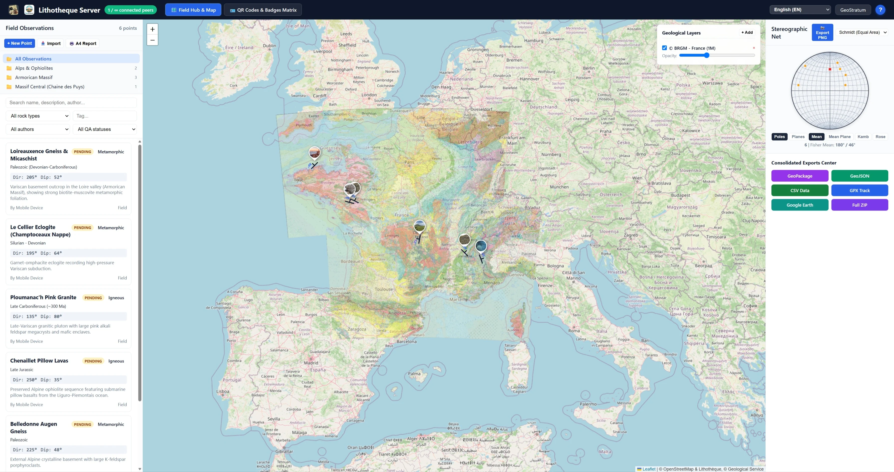

# Lithotheque Server

<p align="center">
  
</p>

<p align="center">
  <strong>Sovereign, High-Performance Offline Synchronization Hub & Structural Geology Computing Server for Field Expeditions</strong>
</p>

<p align="center">
  <a href="#supported-platforms--architectures"></a>
  <a href="https://ghcr.io/geostratum/lithotheque-server"></a>
  <a href="https://wireguard.com"></a>
  <a href="#asymmetric-cryptographic-device-binding--qr-code-enrollment"></a>
  <a href="#core-capabilities"></a>
</p>

<p align="center">
  <a href="#export-formats--gis-interoperability"></a>
  <a href="#enterprise-grade-system-reliability"></a>
  <a href="#core-capabilities"></a>
  <a href="LICENSE"></a>
</p>

---

## 📑 Table of Contents

- [Overview](#-overview)
- [Core Capabilities](#-core-capabilities)
- [Supported Platforms & Architectures](#-supported-platforms--architectures)
- [Quick Start (5 Minutes)](#-quick-start-5-minutes)
- [Export Formats & GIS Interoperability](#-export-formats--gis-interoperability)
- [Accessibility (WCAG 2.2 AA)](#-accessibility-wcag-22-aa)
- [Commercial Licensing & Terms](#️-commercial-licensing--terms)

### Editions & Downloads
- **Team & Enterprise Licensing**: [https://www.geostratum.eu/en-us/lithotheque/serveur/](https://www.geostratum.eu/en-us/lithotheque/serveur/)
- **Personal Edition (1 device, Microsoft Store — 15-day free trial)**: [https://apps.microsoft.com/detail/9NG0MTN8QD4Z](https://apps.microsoft.com/detail/9NG0MTN8QD4Z)

<p>
  <a href="https://get.microsoft.com/installer/download/9NG0MTN8QD4Z?referrer=appbadge" target="_self">
    
  </a>
</p>

---

## 🌍 Overview

**lithotheque-server** (`litho-hub`) is an autonomous, self-hosted edge server engineered specifically for remote geological expeditions, university field geology courses, geotechnical consultancies, and sovereign mining explorations.

Operating directly on an expedition server, rugged field tablet, Docker container, or headless mini-PC (such as Raspberry Pi 5 or Intel NUC), it acts as the centralized offline repository for mobile devices running the **Lithotheque** application (Android & iOS). Field geologists and students synchronize observations, structural measurements (strike, dip, plunge), and high-resolution outcrop photographs over encrypted WireGuard peer-to-peer Wi-Fi or ad-hoc hotspots—**with zero internet, zero cloud dependencies, and zero third-party tracking.**

<p align="center">
  
</p>

---

## ⚡ Core Capabilities

- **Zero-Internet Sovereign Field Operation**: Complete autonomy in remote mountainous valleys, underground mines, active quarries, or exploration sites.
- **Asymmetric Cryptographic Device Binding & QR Code Enrollment**:
  - Secure optical QR code enrollment with extended asynchronous validity (7 to 30 days) for advance distribution on badges or mission briefs.
  - Zero static private key leakage: the QR code contains an ephemeral challenge nonce.
  - Hardware-backed asymmetric key handshake: client device generates an ECDSA P-256 keypair inside hardware (Android `AndroidKeyStore` / Apple `SecureEnclave.P256`), signs the challenge, and permanently binds to the server. Attempting to scan the QR code from another device is strictly blocked.
- **Master GeoPackage & GIS Consolidation**: Automatically aggregates individual field observations into a consolidated GIS GeoPackage (`.gpkg`), GeoJSON, CSV, GPX, and KML layers ready for instant import into **QGIS** or **ArcGIS**.
- **Real-Time Interactive Stereonet (Wulff & Schmidt)**: Live computation of structural stereographic projections (density contours, planes, poles, mean direction) using pure Go vector math.
- **Enterprise-Grade System Reliability**:
  - Pure Go zero-CGO SQLite engine (`modernc.org/sqlite`).
  - Automated atomic SQLite WAL backups and disaster recovery tools.
  - Native Windows Service (Session 0), Linux Systemd daemon, and multi-arch Docker container support.
- **Hardened Multi-Architecture Deployment**:
  - Native pre-compiled binaries for **Linux (x86_64 and ARM64)**, **Windows (x64 and ARM64)**, and **Docker Multi-Arch (GHCR)**.
  - Post-Quantum Cryptography readiness (ML-DSA / Crystals-Dilithium & Ed25519 offline license verification).
  - Obfuscated, symbol-stripped binaries with UPX binary compression.

---

## 📚 Complete Technical Documentation

A comprehensive engineering and operational manual is available in the [`docs/`](docs/) directory:

| Document | Description |
| :--- | :--- |
| **[01. Hardware Requirements & Sizing Guide](docs/01_HARDWARE_REQUIREMENTS.md)** | Dimensioning for laptops, Raspberry Pi 5, mini-PCs, RAM, SSD endurance, and Wi-Fi access points for 5 to 100+ concurrent field devices. |
| **[02. Installation & Operations Manual](docs/02_INSTALLATION_AND_OPERATIONS.md)** | Step-by-step installation for Linux Debian/Ubuntu (`.deb`), Windows Service setup, firewall configuration, and operational lifecycle. |
| **[03. Reverse Proxy, TLS & Hardening Guide](docs/03_REVERSE_PROXY_AND_SECURITY.md)** | Production deployment behind Nginx, Caddy, HAProxy, WireGuard isolation, TLS certificate management, and systemd sandboxing. |
| **[04. Backup & Disaster Recovery Runbook](docs/04_BACKUP_AND_DISASTER_RECOVERY.md)** | Hot backup procedures via `/api/admin/backup`, SQLite online backup API, automated cron/task scheduler scripts, and zero-data-loss restoration. |
| **[05. Error Codes & Troubleshooting Reference](docs/05_ERROR_CODES_AND_TROUBLESHOOTING.md)** | Exhaustive list of error codes (`ERR_LIC_*`, `ERR_WG_*`, `ERR_DB_*`, `ERR_EXP_*`), diagnostic flowcharts, and incident resolution recipes. |
| **[Getting Started & Quick Setup](docs/GETTING_STARTED.md)** | Rapid 5-minute setup guide for field supervisors and expedition leaders. |
| **[User Guide & Field GIS Workflows](docs/USER_GUIDE.md)** | Base camp workflow, observation filtering, BRGM geological layer overlays, and data export usage. |
| **[Licensing & Activation](docs/LICENSING.md)** | Commercial tiers, offline key installation, air-gapped activation, and maintenance periods. |

---

## 📦 Supported Platforms & Architectures

Official releases provide pre-compiled, self-contained packages for standard OS and hardware architectures:

| Platform | Arch | Typical Deployment Hardware | Release Package |
| :--- | :--- | :--- | :--- |
| **Linux Debian / Ubuntu** | `x86_64` (AMD64) | Enterprise servers, Cloud VMs, Field laptops (Dell, Lenovo) | `litho-hub_<version>_amd64.deb` |
| **Linux Debian / Raspberry Pi** | `aarch64` (ARM64) | Raspberry Pi 4 / 5, AWS Graviton, Ampere Altra | `litho-hub_<version>_arm64.deb` |
| **Windows Desktop & Server** | `x86_64` (x64) | Windows 10/11, Windows Server 2019/2022/2025 | `litho-hub-windows-x64.msi` |
| **Windows on ARM** | `ARM64` | Windows on ARM | `litho-hub-windows-arm64.msi` |
| **Docker (OCI Container)** | `AMD64 & ARM64` | Docker Compose, Podman, Kubernetes, Synology / QNAP NAS | `ghcr.io/geostratum/lithotheque-server:latest` |

Download the latest version from the **[Official GitHub Releases](https://github.com/GeoStratum/lithotheque-server/releases/latest)** or pull the container from GHCR.

---

## 🚀 Quick Start (5 Minutes)

### Via Docker Compose (Recommended for Containerized Environments)

```yaml
# docker-compose.yml
services:
  lithotheque-server:
    image: ghcr.io/geostratum/lithotheque-server:latest
    container_name: lithotheque-server
    restart: unless-stopped
    cap_add:
      - NET_ADMIN
    ports:
      - "8080:8080/tcp"
      - "51820:51820/udp"
    volumes:
      - ./config:/etc/litho-hub
      - ./data:/var/lib/litho-hub/data
      - ./exports:/var/lib/litho-hub/exports
    environment:
      - PUID=1000
      - PGID=1000
```

Start the container:
```bash
docker compose up -d
```

### On Debian / Ubuntu Linux

```bash
# 1. Download and install the Debian package
sudo dpkg -i litho-hub_v1.0.0_amd64.deb

# 2. Deposit your commercial license key
sudo cp license.key /etc/litho-hub/license.key
sudo chown -R litho-hub:litho-hub /etc/litho-hub/

# 3. Enable and start the systemd daemon
sudo systemctl enable --now litho-hub

# 4. Access the web dashboard
# Open your browser at http://127.0.0.1:8080
```

### On Windows 10 / 11 / Windows Server

```powershell
# 1. Create standard application data folder
New-Item -ItemType Directory -Force -Path "C:\ProgramData\Lithotheque Hub"

# 2. Copy your license key into the directory
Copy-Item license.key "C:\ProgramData\Lithotheque Hub\license.key"

# 3. Launch the server binary
.\litho-hub.exe -config config.json

# 4. Access the dashboard at http://localhost:8080
```

---

## 🗺️ Export Formats & GIS Interoperability

All synchronized geological data can be exported in one click directly from the dashboard:

```
Exports Consolidés
├── Master GeoPackage (.gpkg)  -> Consolidated SQLite vector layer styled for QGIS
├── GeoJSON (.geojson)          -> Standard vector layer for WebGIS / Mapbox / Leaflet
├── Spreadsheet (.csv)          -> Complete tabular dataset (structural dips, rock types, notes)
├── GPS Coordinates (.gpx)      -> Waypoints and tracks for Garmin GPS outdoor devices
├── Google Earth (.kml)         -> 3D outcrop visualizations with field photo pins
└── Field Archive (.zip)        -> Complete offline archive with original high-res photos
```

---

## ♿ Accessibility (WCAG 2.2 AA)

The web dashboard is engineered to comply with the **Web Content Accessibility Guidelines (WCAG) 2.2 Level AA**:
- **Contrast Ratios**: Strictly calibrated foreground/background contrast (≥ 4.5:1 for standard text, ≥ 5:1 for UI status badges).
- **Keyboard Navigation**: Focus rings with high-visibility `:focus-visible` offset indicators and immediate bypass skip-link.
- **Multilingual ARIA & Alt Tags**: Dynamic localization of all image `alt` attributes and assistive labels across **43 languages**.
- **Touch Target Sizes**: All interactive buttons and close handlers respect the 24×24px to 44×44px minimum target sizes for field touchscreens.

---

## ⚖️ Commercial Licensing & Terms

Lithotheque Base Camp Hub is commercial proprietary software developed by **GeoStratum**. 

- Review the licensing terms in [LICENSE](LICENSE).
- Distribution binary packages are digitally signed and protected against unauthorized modification, reverse engineering, and decompilation.
- For institutional quotes, campus licenses, site deployments, and evaluation inquiries:
  - **Email**: [communication@geostratum.eu](mailto:communication@geostratum.eu)
  - **Order & Team Licensing**: [https://www.geostratum.eu/en-us/lithotheque/serveur/](https://www.geostratum.eu/en-us/lithotheque/serveur/)
  - **Personal Edition (Microsoft Store, 15-day free trial)**: [https://apps.microsoft.com/detail/9NG0MTN8QD4Z](https://apps.microsoft.com/detail/9NG0MTN8QD4Z)

<p>
  <a href="https://get.microsoft.com/installer/download/9NG0MTN8QD4Z?referrer=appbadge" target="_self">
    
  </a>
</p>

---

<p align="center">
  &copy; 2026 GeoStratum. All rights reserved.
</p>
